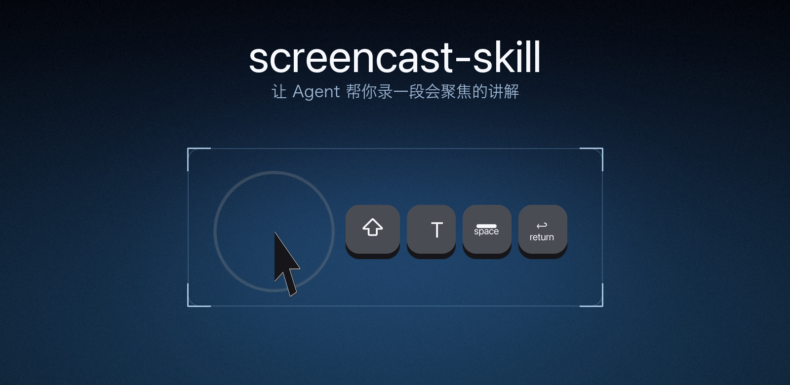
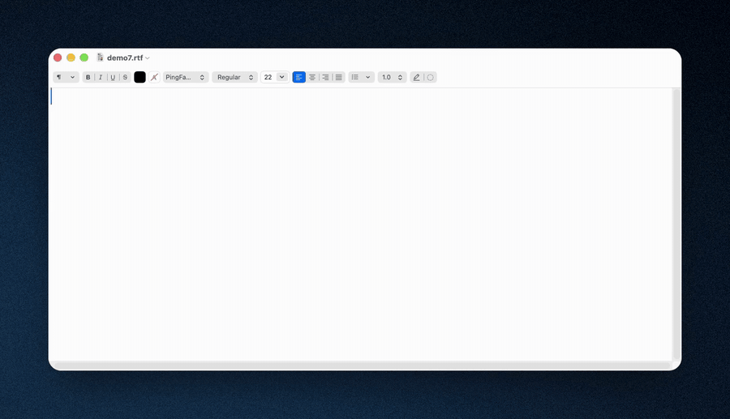

<p align="center">
  
</p>

<h1 align="center">screencast-skill</h1>

<p align="center">让 Agent 帮你录一段会聚焦的讲解。</p>

<p align="center">
  <a href="#它能做什么">它能做什么</a> ·
  <a href="#安装">安装</a> ·
  <a href="#致谢">致谢</a> ·
  <a href="LICENSE">许可</a>
</p>

<p align="center">
  <a href="skills/screencast-skill/scripts/sclib/backends/"></a>
  <a href="skills/screencast-skill/scripts/install.sh"></a>
  <a href="LICENSE"></a>
</p>

---

## 它能做什么

装上它之后，你对 Agent 说"帮我录个演示"，得到的不是一段原始录屏，而是一段**自己会动**的讲解：
点哪里镜头就推向哪里，指针、按键、点击都留痕，画面外面还套着一张卡片。



[完整 MP4（15.0s · 1268×728 · 615KB）](docs/media/demo.mp4) · [封面帧](docs/media/demo-poster.png)

> GitHub 不会内联显示仓库内的 MP4。要在页面上直接播放，用
> `gh issue create --attach docs/media/demo.mp4` 上传后，把生成的链接替换上去。

具体怎么用、能调什么，都写在 [skills/screencast-skill/SKILL.md](skills/screencast-skill/SKILL.md) 里——那是留给 Agent 读的，人不用看。

## 安装

| skill | face | domain | 介绍 |
|---|---|---|---|
| `screencast-skill` | 执行 | 文档 | 录屏并后期重绘成演示视频 |

三种装法，挑一种。

**1. skit（这套生态的推荐工具）**

```bash
skit install vlln/screencast-skill/skills/screencast-skill
skit check
```

仓库还没发布到远端时，用本地目录一样装：`skit install ./screencast-skill/skills/screencast-skill`。

**2. 通用 CLI**（需要 Node.js ≥ 22.20）

```bash
npx skills add vlln/screencast-skill --skill screencast-skill
```

脚本化运行时加 `--agent <名> -y` 跳过交互。

**3. 交给 Agent**

把这句话发给正在用的 Agent：

> 运行 `npx skills use vlln/screencast-skill@screencast-skill`，照它生成的指令把这个 skill 装好。

装到这里就结束了。剩下的（建 Python 环境、装依赖、检查屏幕录制与辅助功能权限）Agent 第一次
用到时会自己做完，需要你点授权时它会告诉你。重复装没有副作用：装过的机器上它只会打印
`already installed` 就停下。

## 致谢

- **键帽画法** — [Keyviz](https://github.com/mulaRahul/keyviz)（四种立体键帽的结构与尺寸）、[ShowMeTheKey](https://github.com/AlynxZhou/showmethekey)（极简键帽条）、[KeyCastr](https://github.com/keycastr/keycastr)（bezel 与淡出）
- **光标、相机、背景** — macOS 自带光标资源（本机栅格化）、[Recordly](https://github.com/webadderallorg/Recordly)（自动聚焦常量与背景体系）
- **视觉规范** — [Apple HIG · Adopting Liquid Glass](https://developer.apple.com/documentation/technologyoverviews/adopting-liquid-glass)
- **库** — [ffmpeg](https://ffmpeg.org/)、[Pillow](https://python-pillow.org/)、[numpy](https://numpy.org/)、[pyobjc](https://pyobjc.readthedocs.io/)

Screen Studio、CleanShot X 是闭源软件，只见过成片，没读过代码。

## License

MIT，见 [LICENSE](LICENSE)。SPDX：`MIT`。
